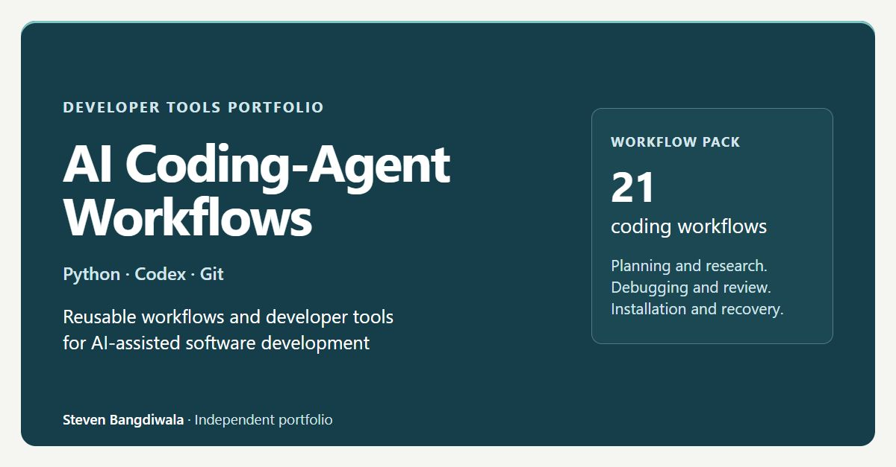
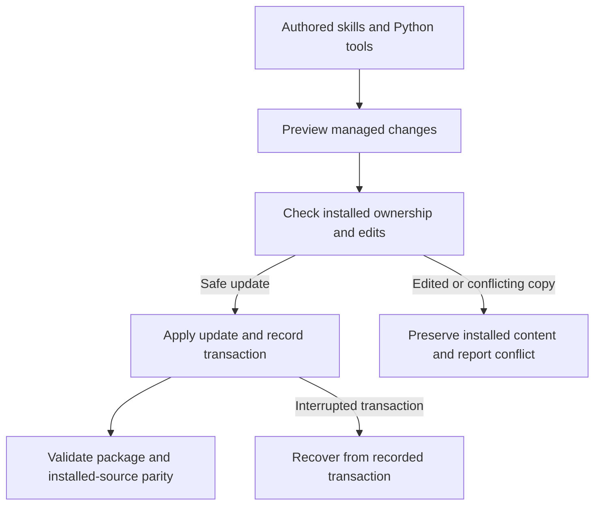

# Programming Agent Skills

**Steven Bangdiwala** · Python tools and 23 task-specific workflows for coding agents



[Implementation and evidence](#engineering-and-evidence) ·
[Controlled demonstrations](docs/astra/engineering-demo.md) ·
[Install](#getting-started) · [Skill catalog](#find-the-right-skill) ·
[User guide](docs/astra/user-guide.md)

[](https://github.com/stevennitesh/programming-agent-skills/actions/workflows/ci.yml)
[](https://github.com/stevennitesh/programming-agent-skills/releases/latest)
[](LICENSE)

Coding agents need project context and a clear finish line. This project supplies
workflows for research, debugging, review and repository maintenance, plus Python
tools to install, update and verify the workflow pack. Each skill defines the task
it covers, when it applies and the result to return. The agent chooses its methods
within the user's scope and repository requirements.

## Engineering and evidence

I developed the workflow boundaries, package validation and supporting Python
tools around ideas credited in [Acknowledgments](ACKNOWLEDGMENTS.md).

| Contribution | What the implementation does | Inspect it |
| --- | --- | --- |
| Managed installation | Previews changes, checks ownership, preserves unrelated skills, and records recoverable update transactions | [Installer](scripts/install_skills.py) and [recovery guide](INSTALLATION.md) |
| Parallel worktree coordination | Creates worktrees from the assigned base, inspects integration and runtime state, and preserves dirty or uncertain work during cleanup | [Worktree helper](skills/astra/parallel-implement/scripts/lane_worktree.py) |
| Package validation | Checks resources, references, catalog invocation rules and requested installed-source parity | [Validator](scripts/validate_skills.py) |
| Agent inspection tools | Generates a navigable codebase atlas and records optional model-use telemetry | [Atlas](skills/astra/audit-codebase/scripts/atlas.py) and [telemetry](skills/astra/controlled-delegation/scripts/telemetry.py) |
| Task selection | Gives each workflow a compact selector and useful exclusions | [Selection examples](docs/astra/selection-examples.md) and [design brief](docs/astra/design-brief.md) |



### Demonstrated behavior

The [controlled examples](docs/astra/engineering-demo.md) exercise three useful
failure cases:

- **Edited installed skill:** an update is refused; the installed tree and global
  instructions stay unchanged.
- **Cleanup failure after commit:** recovery retains the new skill version and
  clears the completed transaction.
- **Ignored worktree files:** cleanup detects artifacts that Git considers clean
  and preserves them.

[CI](https://github.com/stevennitesh/programming-agent-skills/actions/workflows/ci.yml)
runs public validation and the full test suite on Ubuntu and Windows. These tests
establish installer, helper and package behavior. Agent output quality and cost
require separate evaluation; the examples make no productivity claim.

<a id="install"></a>

## Getting started

You'll need [Codex](https://github.com/openai/codex), Git and Python 3.11 or newer.
The installer uses Python's standard library.

```sh
git clone https://github.com/stevennitesh/programming-agent-skills.git
cd programming-agent-skills
python -m scripts.install_skills --dry-run
python -m scripts.install_skills
```

Use `python3` on systems that require it. These commands install the checked-out
source; `main` can differ from the latest tagged release. The installer deploys
`skills/astra/` to `$HOME/.agents/skills` and manages a bootstrap section in
`$HOME/.codex/AGENTS.md`. It preserves unrelated skills and personal instructions.
Use `--skip-global-agents` to install only the skills.

For a clear, bounded code change, ask Codex to implement and verify it directly.
For a specific workflow, request a named skill such as `$shape-work`. Automatic
skills can be selected when their scope matches the task. See the
[user guide](docs/astra/user-guide.md) for examples, model and host boundaries,
and optional model allocation. [Installation and recovery](INSTALLATION.md)
covers updates, custom targets, migration and recovery.

## Find the right skill

**Request explicitly** means Codex waits for you to request that workflow.
**Automatic when relevant** means the agent may select it when its scope matches.

<details>
<summary><strong>Full catalog: all 23 skills and their invocation rules</strong></summary>

| Your task | Skill | Use |
| --- | --- | --- |
| Implement a clear, bounded change | Ask Codex to implement and verify using repository guidance | Direct |
| Develop an idea into an agreed spec, or reconcile domain meaning and decision records | [$shape-work](skills/astra/shape-work/SKILL.md) | Request explicitly |
| Resolve code reuse, ownership, simplification, or integration decisions | [$codebase-design](skills/astra/codebase-design/SKILL.md) | Automatic when relevant |
| Test an uncertain approach with a runnable experiment | [$prototype](skills/astra/prototype/SKILL.md) | Automatic when relevant |
| Create or improve reusable tools for agents to exercise and verify product interfaces | [$verification-harness](skills/astra/verification-harness/SKILL.md) | Request explicitly |
| Research a question or compare options using sources | [$research](skills/astra/research/SKILL.md) | Automatic when relevant |
| Find the root cause of a difficult bug | [$diagnosing-bugs](skills/astra/diagnosing-bugs/SKILL.md) | Automatic when relevant |
| Discover codebase improvements through an HTML map and scoped audits | [$audit-codebase](skills/astra/audit-codebase/SKILL.md) | Request explicitly |
| Optimize a measurable outcome through experiments | [$hillclimb](skills/astra/hillclimb/SKILL.md) | Request explicitly |
| Review a code change for correctness and maintainability | [$change-review](skills/astra/change-review/SKILL.md) | Automatic when relevant |
| Create or update a PR, check its status, or carry requested review and CI follow-through to an authorized endpoint | [$pr-delivery](skills/astra/pr-delivery/SKILL.md) | Automatic when relevant |
| Adopt and finish another actor's PR, branch, or agent work while preserving intent, custody, and contributor credit | [$takeover](skills/astra/takeover/SKILL.md) | Request explicitly |
| Remove low-value tests; consolidate, organize, and streamline useful coverage | [$test-cleanup](skills/astra/test-cleanup/SKILL.md) | Request explicitly |
| Assess or reconcile tracked work, or turn clear ideas into bounded tickets | [$ticketing](skills/astra/ticketing/SKILL.md) | Request explicitly |
| Implement concurrently with separate ownership and clear dependencies | [$parallel-implement](skills/astra/parallel-implement/SKILL.md) | Request explicitly |
| Delegate through one primary worker and limited support while the lead retains decisions and acceptance | [$controlled-delegation](skills/astra/controlled-delegation/SKILL.md) | Request explicitly |
| Route subagent models alongside native Ultra and review before PR delivery | [$ultra-model-routing](skills/astra/ultra-model-routing/SKILL.md) | Request explicitly |
| Resolve an active Git merge or rebase conflict | [$resolving-merge-conflicts](skills/astra/resolving-merge-conflicts/SKILL.md) | Automatic when relevant |
| Assess branches and worktrees, integrate worthwhile work when requested, and clean up safely | [$git-cleanup](skills/astra/git-cleanup/SKILL.md) | Request explicitly |
| Make a project's portfolio artifacts coherent, understandable, and supported by evidence | [$portfolio-presentation](skills/astra/portfolio-presentation/SKILL.md) | Request explicitly |
| Establish repository agent guidance or migrate its setup | [$repo-bootstrap](skills/astra/repo-bootstrap/SKILL.md) | Request explicitly |
| Write or audit reusable agent guidance, a consequential assignment, or a handoff | [$writing-for-agents](skills/astra/writing-for-agents/SKILL.md) | Automatic when relevant |
| Maintain repository context and durable memory, or analyze agent sessions for reusable context and harness improvements | [$context-hygiene](skills/astra/context-hygiene/SKILL.md) | Automatic when relevant |
| Guide a private human step through the terminal and safely hand control back | [$wizard](skills/astra/wizard/SKILL.md) | Request explicitly |

</details>

For matching requests and realistic near-misses, see
[selection examples](docs/astra/selection-examples.md). Current workflow rules live
in each `skills/astra/*/SKILL.md`; the [design brief](docs/astra/design-brief.md)
explains composition and evidence boundaries. Historical packages and evaluation
records remain available without overriding the current pack.

## Sources and contributing

This project began with [Matt Pocock's skills](https://github.com/mattpocock/skills)
and draws on [pstack](https://github.com/cursor/plugins/tree/main/pstack),
[Ponytail](https://github.com/DietrichGebert/ponytail) and
[Superpowers](https://github.com/obra/superpowers), with selected continuation and
PR-delivery ideas from [Tstack](https://github.com/t3dotgg/tstack).
[Acknowledgments](ACKNOWLEDGMENTS.md)
records these influences and the additional source guidance. They are independent
projects, not affiliations.

For changes, start with [CONTRIBUTING.md](CONTRIBUTING.md) and
[AGENTS.md](AGENTS.md). [CONTEXT.md](CONTEXT.md) identifies current source owners
and retained history. [MIT License](LICENSE).
